<!--
  UTKARSH / ENGINEERING INTELLIGENCE
  Profile README — designed as a compact engineering portfolio.
-->

 

  
  

---

<!-- PROFILE-CARDS: generated animated SVG sections begin below. Existing hero above is intentionally preserved. -->

  

  

  
  
  

## What I'm coding

  
  
  

  <a href="https://github.com/codewithutkarsh12?tab=repositories">All repositories</a>
  &nbsp; / &nbsp;
  <a href="https://github.com/codewithutkarsh12">GitHub</a>

  

Built with intent · Activity cards refresh automatically · Keep learning, keep shipping

