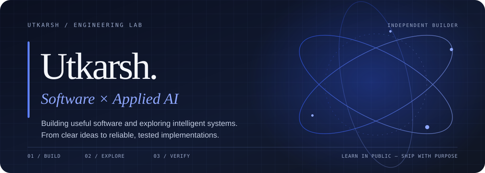

<!--
  UTKARSH / ENGINEERING INTELLIGENCE
  Profile README — designed as a compact engineering portfolio.
-->

 

  
  

---

<table>
<tr>
<td width="58%" valign="top">

### / THE BUILDER

I'm Utkarsh — an aspiring software engineer interested in the systems behind useful products.

I enjoy moving from **problem → architecture → implementation → verification**. My current focus is building strong software engineering fundamentals while exploring Applied AI and reliable agent workflows.

- Currently exploring **AI agents, backend engineering and automation**
- Interested in **developer tools, practical AI and product engineering**
- Building through experiments, iterations and real projects
- Open to learning with builders who value thoughtful engineering

</td>
<td width="42%" valign="top">

### / CURRENT DIRECTION

 
 
 

  

**Principle**

> Make it useful. Make it reliable. Make it better.

</td>
</tr>
</table>

## / SELECTED BUILDS

A few projects from my workshop. Each one is a step toward building more useful and dependable software.

<table>
<tr>
<td width="50%" valign="top">

### 🤖 AUTO — AI Skill Orchestrator

Task routing and workflow orchestration: turning broad requests into structured, executable steps.

[**Explore repository →**](https://github.com/codewithutkarsh12/auto-orchestrator)

</td>
<td width="50%" valign="top">

### 🎓 CampusResolve AI

An AI-assisted campus workflow concept focused on incident triage and resolution.

[**Explore repository →**](https://github.com/codewithutkarsh12/campusresolve-ai)

</td>
</tr>
<tr>
<td width="50%" valign="top">

### 📱 RepRise

A native Android habit-tracking project, exploring Kotlin and modern Android app structure.

[**Explore repository →**](https://github.com/codewithutkarsh12/DAILY-ONE-PUSHUP-INCREASE-)

</td>
<td width="50%" valign="top">

### 🧪 More experiments

Small builds, prototypes and engineering explorations live in my repositories.

[**Browse all repositories →**](https://github.com/codewithutkarsh12?tab=repositories)

</td>
</tr>
</table>

## / TOOLKIT

  Tools are part of the process. Clear thinking, fundamentals and good engineering matter more.

## / ACTIVITY SIGNAL

 

 

## / BEYOND THE CODE

I believe strong engineers stay curious: they read, test assumptions, learn from failed attempts and share what they discover.

If you're building something thoughtful around **software, AI or developer experience**, I'd be happy to connect.

  

Designed with intent · Updated as the work evolves

