<!--
  UTKARSH / ENGINEERING INTELLIGENCE
  Profile README — designed as a compact engineering portfolio.
-->

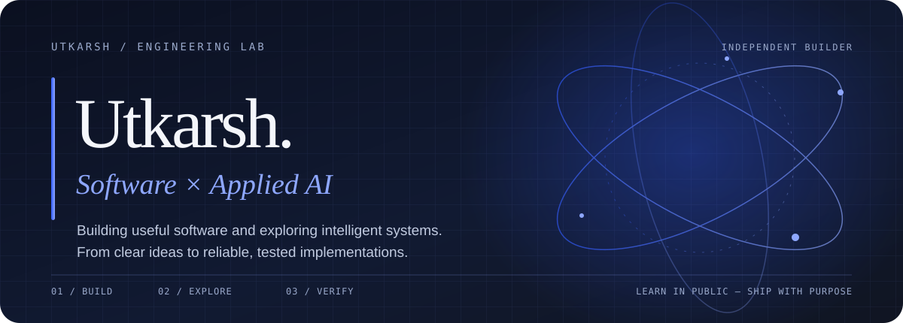

 

  
  

---

<!-- PROFILE-CARDS: generated animated SVG sections begin below. Existing hero above is intentionally preserved. -->

## GitHub Activity

Contribution counts and streaks are generated from GitHub’s public activity calendar and refresh daily. If the cards show an awaiting-data message, check the profile visibility settings below.

  

  

  <a href="https://github.com/codewithutkarsh12?tab=repositories"></a>
  <a href="https://github.com/codewithutkarsh12/auto-orchestrator"></a>
  

## Project Milestones

  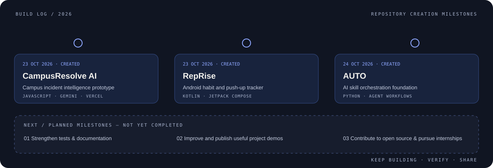

The dates above are **GitHub repository creation dates**, not claims that the projects were completed or launched on those dates. The next milestones are goals, not completed achievements.

- **AUTO:** strengthen orchestration tests, documentation and safe execution boundaries.
- **CampusResolve AI:** improve the prototype, verify the demo and document production-readiness gaps.
- **RepRise:** continue Android testing and refine the habit-tracking experience.
- **Personal goals:** make meaningful open-source contributions and work towards internship opportunities.

## About Me

I'm **Utkarsh**, a BCA student in Pune who learns best by building. I like taking a rough idea, figuring out what it needs, and turning it into something people can try — whether that's a small web app, an Android project or an AI-assisted workflow.

I'm interested in the space where **software engineering meets applied AI**. I use AI tools to explore and prototype faster, but I don't treat generated code as finished work. I want to understand it, test it and make it better.

- 🎓 Studying **BCA** at **Nutan Maharashtra Institute of Engineering and Technology (NMIET), PCET**, Talegaon Dabhade, Pune.
- 🧩 Building and experimenting with **Python, JavaScript and Kotlin**; strengthening C and web fundamentals.
- 🤖 Exploring **AI agents, prompt design, tool use, workflow orchestration and LLM-powered apps**.
- 🛠️ Interested in creating useful websites, Android apps, automations and developer tools.
- 🌱 Learning through small builds, mistakes, feedback and steady improvement.

  

## Education

**Bachelor of Computer Applications (BCA)**  
Nutan Maharashtra Institute of Engineering and Technology (NMIET) · Pimpri Chinchwad Education Trust (PCET)  
Talegaon Dabhade, Pune, Maharashtra, India · **2026 – Present**

## Project-Based Experience

Most of my hands-on experience comes from projects I've planned, built and improved myself. That work has taught me to:

- Break a broad idea into a smaller first version.
- Use AI tools to explore approaches and speed up repetitive work.
- Connect interfaces, application logic and APIs.
- Track changes with Git and GitHub.
- Test important paths, review generated code and write down known limitations.

*This is independent project experience, not a formal job or internship.*

## Skills & Tools

### Software & Web

- **Used in projects:** Python, JavaScript and Kotlin.
- **Learning now:** C, CSS, data structures and core programming concepts.
- **Web work:** building responsive interfaces, connecting APIs and debugging front-end behaviour.

### AI & Agent Workflows

I'm exploring how to make AI features useful and predictable:

- Writing prompts and breaking larger requests into smaller tasks.
- Connecting Gemini APIs to application prototypes.
- Exploring skill discovery, tool selection and workflow routing.
- Designing multi-step agent workflows with clear context and execution boundaries.
- Checking structured outputs and keeping human review in the loop.
- Using vibe coding for quick prototypes, then reading, testing and refining the generated code.

### Android Development

- Kotlin-based Android development through the RepRise project.
- Project exposure to Jetpack Compose, MVVM, Room and DataStore.
- Learning to structure app logic and test important behaviours.

### Developer Tools

**AI tools I work with:** ChatGPT · Google Gemini · Google AI Studio · Antigravity

*These are areas of project use and active learning, not claims of expert-level proficiency.*

## What I Build

- **AI-assisted apps:** useful features built around LLM APIs and clear user workflows.
- **Agent experiments:** task breakdown, tool selection, routing and multi-step automation.
- **Web projects:** responsive pages, dashboards and front-end experiences connected to APIs.
- **Android apps:** Kotlin projects with local data and practical everyday features.
- **Fast prototypes:** using AI to explore an idea quickly, then checking the code and improving the result.

## Featured Projects

### 🤖 [AUTO — AI Skill Orchestrator](https://github.com/codewithutkarsh12/auto-orchestrator)

A Python foundation for turning complex prompts into structured, skill-powered workflows.

- Decomposes requests into actionable tasks.
- Matches tasks to skills and routes work through a dependency-aware pipeline.
- Includes context/token budgeting and structured execution traces.
- Designed with safe-by-default boundaries; the current repository describes itself as an **early-stage reference implementation**, not a production agent runtime.

**Stack:** Python · Task orchestration · Skill routing · Testing

### 🎓 [CampusResolve AI](https://github.com/codewithutkarsh12/campusresolve-ai)

An AI-assisted campus incident intelligence prototype · [Live demo](https://codewithutkarsh12-campusresolve-m1yktc6z1-utkarsh605s-projects.vercel.app).

- Demonstrates incident reporting, structured triage, recurring-fault review and workflow tracking.
- Includes an optional server-side Gemini integration and a clearly labelled deterministic demo fallback.
- Includes automated tests and security-focused handling.
- Uses synthetic demo records; it is **not yet a production multi-user campus operations system**.

**Stack:** JavaScript · Node.js · Gemini API · Vercel · Testing

### 💪 [RepRise — Daily Push-Up Tracker](https://github.com/codewithutkarsh12/DAILY-ONE-PUSHUP-INCREASE-)

A native Android habit-tracking project built around a progressive daily push-up challenge.

- Tracks daily targets, streaks, workout history and milestones.
- Uses offline-first local storage and configurable reminders.
- Separates UI, challenge logic, persistence and notification workflows.

**Stack:** Kotlin · Jetpack Compose · MVVM · Room · DataStore · JUnit

## Currently Learning

- Data structures, algorithms and stronger computer science fundamentals.
- Backend development, REST APIs, databases and SQL.
- Writing cleaner Python, testing code and understanding software architecture.
- Applied AI: LLM applications, RAG, agent evaluation and reliable tool use.
- Cloud and deployment basics, including Docker and CI/CD.

## Learning & Credentials

- **Microsoft Elevate — AI Skills Passport** · Badge earned October 2026.

## How I Build

My usual approach is simple: understand the problem, choose a small first version, build it, test the important parts and improve what doesn't work. AI can speed up parts of that process, but the final checks still matter.

  

## More From My Workshop

  <a href="https://github.com/codewithutkarsh12/auto-orchestrator"></a>
  <a href="https://github.com/codewithutkarsh12/campusresolve-ai"></a>
  <a href="https://github.com/codewithutkarsh12/DAILY-ONE-PUSHUP-INCREASE-"></a>

  <a href="https://github.com/codewithutkarsh12?tab=repositories">Explore all repositories</a>
  &nbsp; / &nbsp;
  <a href="https://github.com/codewithutkarsh12">Follow on GitHub</a>

  

Built with intent · Activity cards refresh automatically · Keep learning, keep shipping

