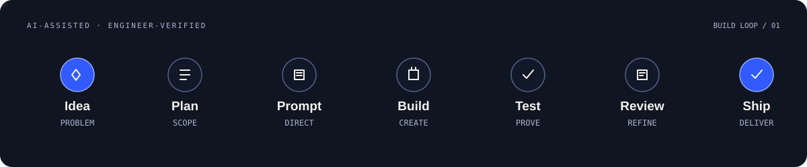

<!--
  UTKARSH / ENGINEERING INTELLIGENCE
  Profile README — designed as a compact engineering portfolio.
-->

 

  
  

---

<!-- PROFILE-CARDS: generated animated SVG sections begin below. Existing hero above is intentionally preserved. -->

## About Me

I'm **Utkarsh Bhosale**, a BCA student and independent builder from Pune, India. I enjoy turning ideas into practical software — from web experiences and Android apps to AI-assisted tools and agent workflows.

My current direction is **Software Engineering × Applied AI**: strong engineering fundamentals first, then reliable AI-powered products. I use AI tools to move faster, but I care about understanding the code, testing behaviour and reviewing what ships.

- 🎓 Studying **Bachelor of Computer Applications (BCA)** at **Nutan Maharashtra Institute of Engineering and Technology (NMIET), PCET**, Talegaon Dabhade, Pune.
- 🧠 Exploring **AI agents, prompt engineering, workflow orchestration and LLM-powered applications**.
- 🛠️ Building with **Python, JavaScript and Kotlin**, while strengthening core programming and web fundamentals.
- 🌱 Learning in public through experiments, projects and iteration.

## Education

**Bachelor of Computer Applications (BCA)**  
Nutan Maharashtra Institute of Engineering and Technology (NMIET) · Pimpri Chinchwad Education Trust (PCET)  
Talegaon Dabhade, Pune, Maharashtra, India · **2026 – Present**

## Engineering Experience

### Independent Software Builder · Project-based experience

I build and iterate on personal software projects, taking ideas through planning, implementation, testing and deployment.

- Translate a problem into a small, buildable product scope.
- Use AI-assisted development and prompt-driven prototyping without treating generated code as automatically correct.
- Connect frontend experiences to APIs and backend workflows.
- Use Git and GitHub to version, document and improve projects.
- Review edge cases, run tests and document limitations before presenting a build.

*This section describes independent project work, not paid employment or a claimed internship.*

## Skills & Tools

### Programming & Web

- **Project experience:** Python, JavaScript, Kotlin.
- **Foundations:** HTML; currently strengthening C and CSS.
- **Web development:** responsive interfaces, frontend logic, API integration and debugging.

### AI, LLMs & Agent Engineering

- Prompt design and structured task decomposition.
- Gemini API integration and LLM-powered application prototypes.
- Skill discovery, capability matching and workflow routing.
- Agent workflow architecture, bounded execution and context management.
- Structured output validation and safety-aware tool design.
- AI-assisted / vibe-coded prototyping with human review and testing.

### App Development

- Android development with Kotlin.
- Jetpack Compose, MVVM, Room and DataStore in the RepRise project.
- Unit testing and Android-focused test workflows.

### Developer Tools & Platforms

**AI development tools:** ChatGPT · Google Gemini · Google AI Studio · Antigravity

## What I Build

- **AI agents & automation:** task decomposition, skill routing, multi-step workflows and tool orchestration.
- **AI-powered products:** LLM integrations, Gemini-powered features and practical AI interfaces.
- **Web applications:** responsive websites, dashboards, frontend/backend integration and deployment.
- **Android applications:** Kotlin-based apps, local data, app architecture and user workflows.
- **Vibe coding:** fast AI-assisted prototyping followed by code review, testing and refinement.

## Featured Projects

### 🤖 [AUTO — AI Skill Orchestrator](https://github.com/codewithutkarsh12/auto-orchestrator)

A Python foundation for turning complex prompts into structured, skill-powered workflows.

- Decomposes requests into actionable tasks.
- Matches tasks to skills and routes work through a dependency-aware pipeline.
- Includes context/token budgeting and structured execution traces.
- Designed with safe-by-default boundaries; the current repository describes itself as an **early-stage reference implementation**, not a production agent runtime.

**Stack:** Python · Task orchestration · Skill routing · Testing

### 🎓 [CampusResolve AI](https://github.com/codewithutkarsh12/campusresolve-ai)

An AI-assisted campus incident intelligence prototype · [Live demo](https://codewithutkarsh12-campusresolve-m1yktc6z1-utkarsh605s-projects.vercel.app).

- Demonstrates incident reporting, structured triage, recurring-fault review and workflow tracking.
- Includes an optional server-side Gemini integration and a clearly labelled deterministic demo fallback.
- Includes automated tests and security-focused handling.
- Uses synthetic demo records; it is **not yet a production multi-user campus operations system**.

**Stack:** JavaScript · Node.js · Gemini API · Vercel · Testing

### 💪 [RepRise — Daily Push-Up Tracker](https://github.com/codewithutkarsh12/DAILY-ONE-PUSHUP-INCREASE-)

A native Android habit-tracking project built around a progressive daily push-up challenge.

- Tracks daily targets, streaks, workout history and milestones.
- Uses offline-first local storage and configurable reminders.
- Separates UI, challenge logic, persistence and notification workflows.

**Stack:** Kotlin · Jetpack Compose · MVVM · Room · DataStore · JUnit

## Currently Learning

- Data structures and algorithms, problem solving and computer science fundamentals.
- Backend engineering, REST APIs, databases and SQL.
- Python depth, clean code, testing and software architecture.
- Applied AI: LLM applications, agent evaluation, RAG fundamentals and reliable tool use.
- Cloud basics, deployment, Docker and CI/CD.

## Learning & Credentials

- **Microsoft Elevate — AI Skills Passport** · Badge earned October 2026.

## How I Build

I like a simple loop: understand the problem, plan the smallest useful version, use AI as a development accelerator, then verify the result before shipping.

  

## GitHub Activity

  

  

  
  
  

## More From My Workshop

  
  
  

  <a href="https://github.com/codewithutkarsh12?tab=repositories">Explore all repositories</a>
  &nbsp; / &nbsp;
  <a href="https://github.com/codewithutkarsh12">Follow on GitHub</a>

  

Built with intent · Activity cards refresh automatically · Keep learning, keep shipping

